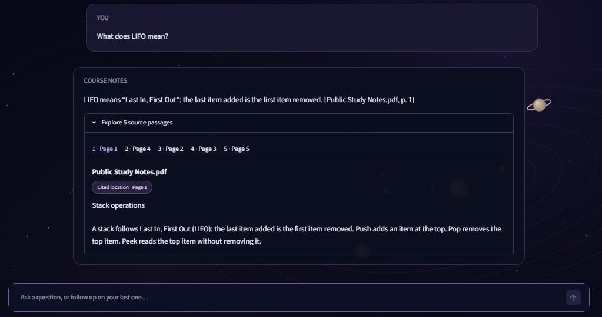

# After Hours · Course Notes Assistant
[](https://github.com/almeerimran261-collab/after-hours-study-assistant/actions/workflows/tests.yml)
[**Open the live demo →**](https://after-hours-study-assistant-nyqpmod7g2yhs6lyqegbkm.streamlit.app/)

A study assistant that answers questions from PDFs and lecture slides, with
page or slide citations and an animated space-themed Streamlit interface.

The public demo uses an original five-page study guide and Groq. Local mode
uses your own documents and Ollama. Retrieval runs on CPU in both modes.

## What the project demonstrates

- PDF text extraction, OCR fallback, table extraction, and PPTX processing.
- BGE vector search plus BM25, reciprocal rank fusion, and cross-encoder reranking.
- Relevance-based refusal and validation of citation source/location membership.
- Session question memory for basic conditional follow-ups.
- Separate document collections, inspectable source passages, and chat export.
- Local PDF/PPTX uploads with indexing progress, session isolation, and document removal.
- A public sample database isolated from the local course database.
- Groq requests restricted to exact excerpts from the built-in public sample.

## Run the public sample locally

Use Python 3.11. In a Windows terminal:

```powershell
git clone https://github.com/almeerimran261-collab/after-hours-study-assistant.git
cd after-hours-study-assistant
python -m venv .venv
.\.venv\Scripts\python.exe -m pip install -r requirements.txt
.\.venv\Scripts\python.exe .\run_public_demo.py
```

The launcher asks for a Groq API key using hidden terminal input. The key is
passed to the child process without saving it in a project file. First startup
downloads the embedding/reranking models as needed and generates the sample PDF
and Chroma index. On Linux, use `.venv/bin/python` instead.

Try these questions in order:

1. What does LIFO mean?
2. What does insertAtEnd do when head is NULL?
3. And when it is not empty?
4. What is the weather in Karachi right now?

The first answer should cite page 1, the next two should cite page 5, and the
weather question should be refused. Open the source passages to inspect evidence.

## Use Ollama with your own documents

Install the additional local dependencies and start the local app:

```powershell
.\.venv\Scripts\python.exe -m pip install -r requirements-local.txt
ollama pull qwen3:4b-instruct
$env:RAG_MODE = 'local'
.\.venv\Scripts\python.exe -m streamlit run app.py
```

Ollama must be running. Open **Upload documents** in the sidebar, select PDF or
PPTX files, and click **Index selected files**. Progress covers extraction and
embedding batches. No prebuilt database is needed. Native PDF/PPTX text works
without Tesseract; for scanned pages or slide pictures on Windows, install
Tesseract and set `TESSERACT_DIR` to its folder. Extraction warnings appear in
the upload panel; unsupported, unreadable, or entirely empty files fail the batch.

Uploads use a separate in-memory index for each browser session. The latest
successful batch replaces the previous uploaded batch; failed builds leave the
previous batch active. Use **Remove selected documents** to rebuild with fewer
files, or **Clear uploaded documents** to release the batch and its conversation.
Changing the document set resets question memory. Uploads disappear when the
session is released or the server restarts; keep the original files on your computer.
Disconnect cleanup is best effort. Limits: 6 files, 20 MB each, 60 MB total,
300 pages/slides, and 5,000 passages. OCR and embedding can take time on CPU.

Existing saved collections remain selectable and are never changed by the upload
controls. For the older persistent-index CLI, place files in `data/` and run
`python -m src.phase1_cli ingest`. That separate command rebuilds its selected
local index, so back it up before re-ingesting documents you want to retain.

Uploads are local-only. The public Groq demo continues to use its built-in sample.

## How an answer is produced

```text
Question -> conditional follow-up resolution -> BGE vector search + BM25
         -> reciprocal rank fusion -> cross-encoder reranking
         -> relevance threshold -> Ollama or Groq
         -> citation validation -> answer + inspectable passages
```

`RAG_MODE=local` uses `chroma_db` and Ollama. `RAG_MODE=demo` generates the
original sample in `demo_chroma_db` and uses Groq (`openai/gpt-oss-20b`). The
Cloud entrypoint, `public_app.py`, explicitly selects demo mode. Course
collections, documents, databases, model caches and API keys are not bundled.

## Deploy on Streamlit Community Cloud

1. Connect this GitHub repository in Streamlit Community Cloud.
2. Select `public_app.py` as the entrypoint and Python **3.11** in Advanced settings.
3. Add the following server secrets, replacing the placeholder in host settings:

```toml
RAG_MODE = "demo"
GROQ_API_KEY = "your-key-in-host-settings"
```

4. Deploy and run the sample questions above. Check startup logs and memory use.

The key stays in server settings. Hosted questions and retrieved public-sample
passages are sent to Groq. The demo has no document upload workflow. Groq free
quotas and Community Cloud resources may limit availability or latency. Model
weights and the generated index are downloaded/rebuilt after a fresh start.

Official guides: [deployment](https://docs.streamlit.io/deploy/streamlit-community-cloud/deploy-your-app/deploy)
and [secrets](https://docs.streamlit.io/deploy/streamlit-community-cloud/deploy-your-app/secrets-management).

## Evaluation and limits

The public sample has five passages and retrieval returns up to five. It checks
deployment, citations, follow-ups and refusals; it is not a retrieval-quality
benchmark. Larger-corpus evaluations should report retrieval and generation
separately and keep Ollama and Groq results separate.

Citation validation checks whether the cited source and page/slide occur in the
retrieved context. It does not prove every claim is supported or the answer is
complete. The reranker threshold is provisional, and conversational rewriting
supports limited patterns rather than general dialogue understanding.

`eval/phase8_groq_smoke_test.py` is an additional synthetic API/citation-format
check. It makes an external Groq request when run and asks for its own key.
Historical course-corpus evaluation outputs are excluded from this public export.

## Main files

| File | Purpose |
| --- | --- |
| `app.py` | Chat interface and collection selection |
| `public_app.py` | Cloud entrypoint using the public sample |
| `src/ingest.py`, `src/pptx_ingest.py` | PDF/PPTX extraction and OCR |
| `src/local_workspace.py`, `src/local_upload_ui.py` | Local session uploads, progress, and safe replacement/removal |
| `src/retriever.py` | Hybrid retrieval and reranking |
| `src/generator.py` | Relevance checks and citation validation |
| `src/model_provider.py` | Ollama/Groq requests |
| `src/public_demo.py` | Authored public notes and isolated index setup |
| `src/memory.py` | Recent-question context |
| `src/cosmos.py`, `src/branding.py` | Wallpaper and branding |

The local prototype and public demo use existing embedding and language models;
this project does not train a foundation model.

## Public retrieval benchmark

A fixed synthetic development set of **40 text-only PDF pages across 8 documents**
and **40 answerable questions**, with one labeled source page per question.
This uses a separate dataset from the hosted demo.

| Pipeline | Hit@1 | Hit@5 | MRR@5 | Mean retrieval ms | p95 ms |
| --- | ---: | ---: | ---: | ---: | ---: |
| Vector only | 90.0% | 100.0% | 0.944 | 44.4 | 62.3 |
| Hybrid + reranking | 92.5% | 100.0% | 0.956 | 602.6 | 759.7 |

The hybrid pipeline placed the labeled page first for **37/40 questions**, versus
**36/40** for vector search. Both retrieved it within five results for **40/40**.
The extra first-place hit came with about **13.6x higher mean retrieval latency**
on this run. This compares the complete pipelines, including BM25, fusion,
and reranking.

Measured on Windows with Python 3.11.9 and CPU inference. Model loading, index
construction, and one warm-up per pipeline are excluded from retrieval timings.

Hit@k measures recovery of the exact labeled page. MRR@5 rewards higher placement
and assigns zero to misses. Generated-answer quality and performance on unseen
courses require separate evaluation.

[Report](eval/benchmark_results/3274f1d7/REPORT.md) ·
[JSON summary](eval/benchmark_results/3274f1d7/summary.json) ·
[Per-question CSV](eval/benchmark_results/3274f1d7/questions.csv) ·
[Original source notes](eval/benchmark_results/3274f1d7/notes/)

To rerun, install `requirements.txt` and run from the repository root:

```text
python -m eval.public_retrieval_benchmark
```

The script uses a fresh in-memory index and makes no Groq or Ollama calls.
Each run writes a new results directory.



## Numeric-list citation check

Copied ordered numeric lists are checked against their cited retrieved passages. A detected mismatch gets one correction attempt, which is validated again and must preserve the original numeric lists. General semantic support remains outside this narrow guard. See [scope and verification](docs/citation-checks.md).
